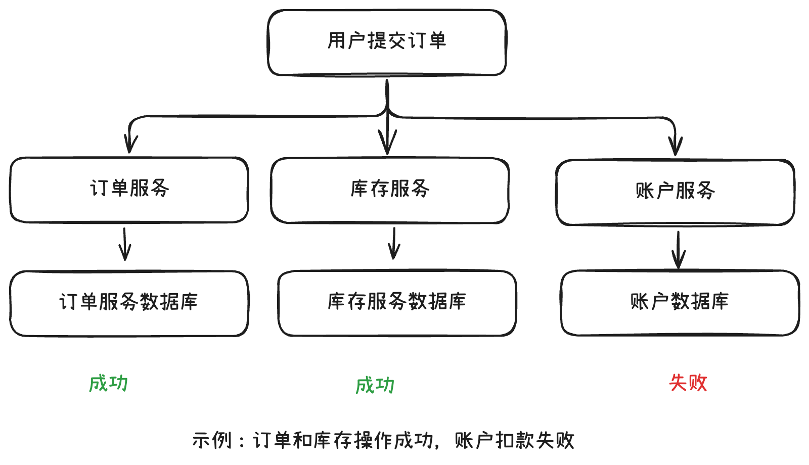
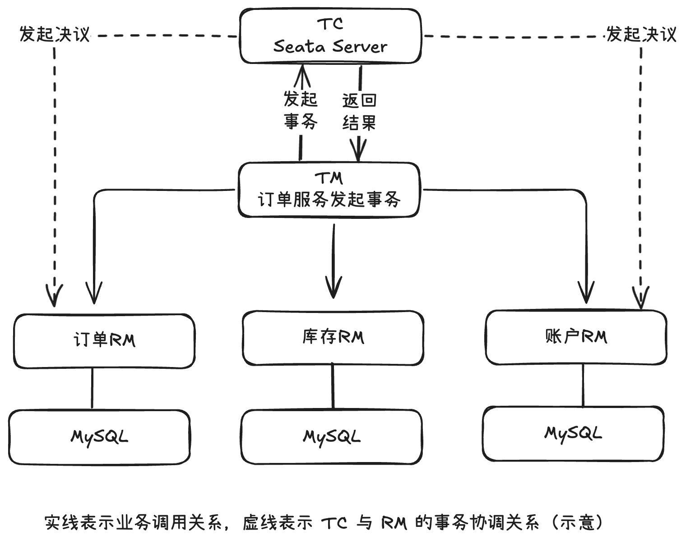
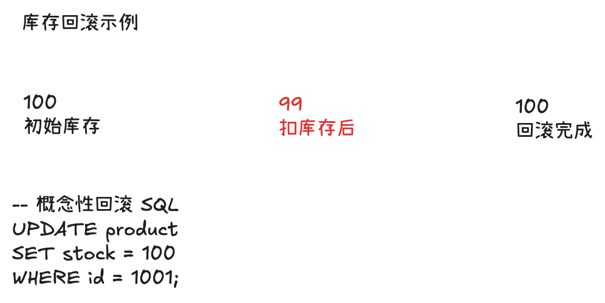
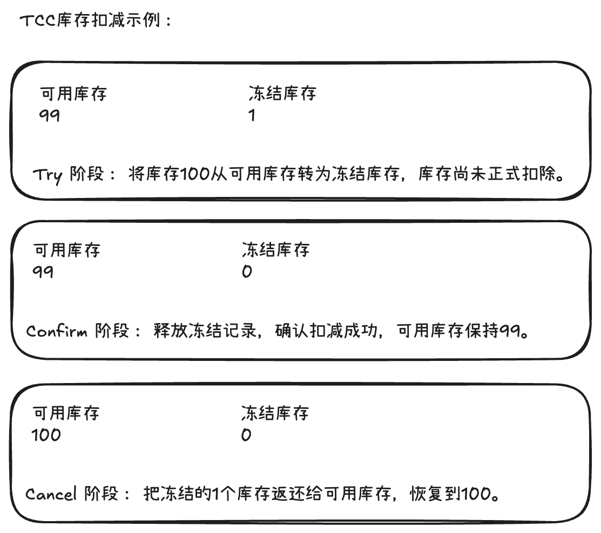
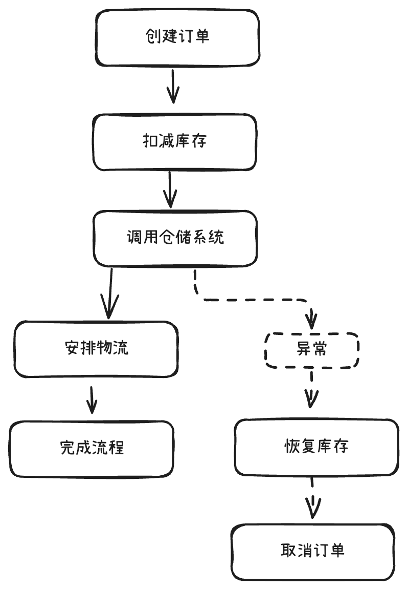

Seata（Simple Extensible Autonomous Transaction Architecture）是一个开源的分布式事务框架，主要用于解决微服务架构下，多个服务、多个数据库之间的数据一致性问题。

Seata 支持 AT、TCC、Saga、XA 四种事务模式。其中，AT 模式最容易上手，也是 Java 后端面试中需要重点掌握的模式。

## 为什么需要 Seata？

假设有一个商城系统，用户下单需要完成三个操作：
1. 订单服务：创建订单。
2. 库存服务：扣减库存。
3. 账户服务：扣减用户余额。

三个服务分别使用独立的 MySQL 数据库。

如果使用 Spring 的 @Transactional：

```java
@Transactional
public void createOrder() {
    orderService.createOrder();
    stockService.deductStock();
    accountService.deductBalance();
}
```

就可能出现：订单创建成功、库存扣减成功，但账户扣款失败。

原因在于：
- @Transactional 依赖本地事务管理器，通常只能管理当前数据源的事务。
- 三个服务分别管理自己的数据库事务。
- 某个服务本地事务提交后，其他服务无法简单地将它回滚。

Seata 就是用来协调这些跨服务的本地事务，让它们作为一个整体执行。

## Seata 的核心架构

Seata 的架构包含三个核心角色：

|角色	|名称|	职责|
|---|---|---|
|TC|Transaction Coordinator|事务协调器，维护全局事务状态，协调提交或回滚|
|TM|Transaction Manager|事务管理器，负责开启、提交、回滚全局事务|
|RM|Resource Manager|资源管理器，管理分支事务，执行本地提交或回滚|

可以这样理解：
- TM 是事务的发起者。
- TC 是事务的总协调者。
- RM 是具体执行事务的参与者。

需要注意：TM、RM 不是必须独立部署的服务器，而是集成在业务应用里的 Seata 客户端角色。TC 则通常通过 Seata Server 独立部署。

一次典型的全局事务执行过程：
1. TM 向 TC 申请开启全局事务。
2. TC 生成全局事务 ID，也就是 XID。
3. TM 调用库存、账户等服务时传播 XID。
4. 各服务的 RM 向 TC 注册分支事务，执行自己的数据库操作。
5. 全部成功，TM 请求全局提交；出现异常，TM 请求全局回滚。
6. TC 协调各分支完成后续提交或回滚。

Seata 通过这些步骤，将原本相互独立的本地事务组织成一个全局事务。

## Seata 支持的四种事务模式

模式	核心机制	优点	缺点	适用场景
AT	自动生成 Undo Log，实现回滚	业务侵入小，开发简单	存在全局锁竞争	常规数据库微服务
TCC	Try、Confirm、Cancel	灵活、可控制资源锁定粒度	业务开发复杂	支付、余额、库存预留
Saga	正向事务 + 反向补偿	支持长事务、异步流程	隔离性较弱，补偿复杂	订单履约、复杂工作流
XA	数据库原生 XA 两阶段提交	较强的事务一致性保障	数据库锁持有时间长	短事务、较低并发场景

这四种模式并非简单的性能高低关系，而是适合不同的一致性要求和业务模型。

## AT 模式的核心原理

AT（Automatic Transaction）是基于两阶段提交思想的分布式事务模式。

与传统 XA 两阶段提交最大的区别在于：

**AT 在第一阶段就提交本地数据库事务，第二阶段通过 Undo Log 进行反向补偿，不需要长期持有数据库本地事务锁。**

### 第一阶段：执行业务 SQL，记录 Undo Log

假设库存表的数据：

```sql
id = 1001
stock = 100
```

业务执行：

```sql
UPDATE product
SET stock = stock - 1
WHERE id = 1001 AND stock >= 1;
```

Seata 的数据源代理会围绕这次更新，进行如下操作：


其中有两个重要的数据快照：
- Before Image （前镜像）：100（操作前的库存）
- After Image（后镜像）：99（操作后的库存）

Seata 把前后镜像等信息记录到业务数据库的 undo_log 表中。

需要强调：**业务 SQL 的修改和 undo_log 的写入，处于同一个数据库本地事务中。**

所以即使第一阶段发生故障，也不会正常出现业务数据已经提交、但回滚日志尚未提交的情况。

### 第二阶段：全局提交

如果订单、库存、账户三个服务都执行成功：
1. TM 通知 TC 提交全局事务。
2. TC 协调各个 RM 提交。
3. AT 分支不需要重新提交业务数据，因为第一阶段已提交。
4. Seata 异步清理对应的 undo_log，释放全局锁。

因此，AT 模式的第二阶段提交通常很轻量。

### 第二阶段：全局回滚

如果账户扣款失败，TC 就会通知已执行成功的分支进行回滚。

例如库存由 100 变成了 99。

RM 执行以下步骤：
1. 根据 XID、Branch ID 找到对应的 Undo Log。
2. 读取当前数据库中的库存。
3. 将当前值与 After Image 比较，进行脏写校验。
4. 如果数据符合回滚条件，利用 Before Image 生成反向 SQL。
5. 执行反向 SQL，恢复库存。
6. 提交本地回滚事务并报告结果。



以上是简化案例，实际的回滚 SQL 由 Seata 根据数据镜像及 SQL 类型生成，而不是简单地对所有库存更新执行 `stock + 1`。

Seata 的 AT 模式完整机制可参考 Apache Seata 官方 AT 原理文档

###  AT 模式中的全局锁有什么作用？

假设两个分布式事务同时扣减同一个商品的库存：
- 事务 A 首先扣减库存，并获取商品记录的 Seata 全局锁。
- 事务 A 第一阶段提交后，数据库本地锁释放，但全局锁仍然存在。
- 事务 B 也要修改该记录，即使获得了 MySQL 本地锁，仍需等待全局锁。
- 直到事务 A 全局提交或回滚完成，事务 B 才能继续完成对应的分支事务。

因此需要区分：
|锁|	管理者|	作用|
|---|---|---|
|本地锁|	MySQL InnoDB|	保护单个数据库事务的并发修改|
|全局锁	|Seata TC|	协调分布式事务之间的写入冲突|

**全局锁主要解决脏写问题，而不是普通查询的脏读问题。**

因为 AT 第一阶段已经提交了数据，普通 `SELECT` 可能读到一个尚未全局提交、随后又被回滚的中间结果。如果业务需要更强的全局读隔离，可以按场景使用 `SELECT ... FOR UPDATE` 并配合 Seata 的事务或全局锁机制。普通的非 Seata 写入也不会自动遵守 Seata 全局锁。

## TCC、Saga、XA 的原理

### TCC：业务层的两阶段提交

TCC 分为三个动作：
- Try：检查并预留资源。
- Confirm：确认事务，正式使用资源。
- Cancel：取消事务，释放预留资源。

例如商品库存有100，需要扣减 1。


在代码层面，可以使用 `@TwoPhaseBusinessAction`：

```java
public interface StockTccAction {

    @TwoPhaseBusinessAction(
        name = "stockDeduct",
        commitMethod = "confirm",
        rollbackMethod = "cancel"
    )
    boolean tryDeduct(
        BusinessActionContext context,
        @BusinessActionContextParameter(
            paramName = "skuId"
        ) Long skuId,
        @BusinessActionContextParameter(
            paramName = "quantity"
        ) Integer quantity
    );

    boolean confirm(BusinessActionContext context);

    boolean cancel(BusinessActionContext context);
}
```

开发者需要实现三个方法，其中 confirm 和 cancel 通常还需要根据 XID、Branch ID 实现幂等控制。

TCC 要特别处理三类问题：**幂等**、**空回滚**、**业务悬挂**。

例如，Cancel 比 Try 更早到达，就属于空回滚场景；不能因为没有找到冻结记录就简单地忽略它，还需要防止后续迟到的 Try 再次冻结资金。

### Saga：适合长事务

假设商城订单履约流程是：



Saga 的特点是每个正向操作独立提交本地事务。

如果某一步失败，就通过预先定义的补偿操作撤销此前已完成的业务效果。

它不像 AT 那样依赖 Undo Log，而是需要业务自己设计补偿逻辑。

例如物流系统已经安排快递时，简单地删除一条数据库记录并不能撤销实际的物流操作，需要调用对应的取消物流接口。

Seata 的 Saga 支持通过状态机引擎编排这些流程。

### XA：数据库原生两阶段提交

XA 模式依赖数据库本身提供的 XA 事务能力。

第一阶段执行 SQL 并 `PREPARE`，但不会像 AT 一样直接完成普通本地提交。

第二阶段由 TC 协调执行 XA Commit 或 XA Rollback。

XA 的优势是数据库直接管理事务提交与恢复，但相应的事务锁和资源占用时间通常更长。

**AT：先提交本地事务，必要时补偿回滚。**

**XA：先准备事务，等待全局决议后再提交或回滚。**

## Spring Cloud + Seata AT 实战

以 Spring Boot 3、Spring Cloud、OpenFeign、MyBatis、MySQL 为例。

### 第一步：部署 Seata Server

首先需要单独部署 TC 服务，可以通过 Docker、Docker Compose 或 Kubernetes 部署。

本地测试时可使用 Seata Server 的文件存储模式。生产环境建议部署高可用 TC 集群，并使用合适的持久化存储与注册中心。

### 第二步：添加 Maven 依赖

业务服务中引入 Seata Starter：

```xml
<dependency>
    <groupId>org.apache.seata</groupId>
    <artifactId>seata-spring-boot-starter</artifactId>
    <version>2.6.0</version>
</dependency>
```

这里使用已发布的 2.6.0 作为示例版本。实际工程需要统一 Server 和 Client 的兼容版本，并避免通过不同 Starter 重复引入 Seata 的数据源代理和事务扫描器。

### 第三步：配置 application.yml

假设 Seata Server 已注册到 Nacos：

```yaml
seata:
  enabled: true

  # 事务分组
  tx-service-group: my_tx_group

  # AT模式
  data-source-proxy-mode: AT

  # 开启数据源自动代理
  enable-auto-data-source-proxy: true

  registry:
    type: nacos
    nacos:
      application: seata-server
      server-addr: 127.0.0.1:8848
      group: SEATA_GROUP
      namespace: ""

  service:
    vgroup-mapping:
      my_tx_group: default
```

其中：
- tx-service-group 是业务使用的事务分组。
- vgroup-mapping 把事务分组映射到 TC 集群。
- default 必须与 Seata Server 注册时使用的集群名称匹配。
- 所有参与同一分布式事务的微服务都需要正确连接 TC。

### 第四步：创建 undo_log 表

AT 模式需要在参与事务的每个业务数据库中建立 undo_log 表。

比如三个独立数据库：

```
order_db
  ├── orders
  └── undo_log

stock_db
  ├── product_stock
  └── undo_log

account_db
  ├── account
  └── undo_log
```

MySQL 建表脚本可以参考：

```sql
CREATE TABLE IF NOT EXISTS undo_log (
    id BIGINT NOT NULL AUTO_INCREMENT,
    branch_id BIGINT NOT NULL,
    xid VARCHAR(128) NOT NULL,
    context VARCHAR(128) NOT NULL,
    rollback_info LONGBLOB NOT NULL,
    log_status INT NOT NULL,
    log_created DATETIME(6) NOT NULL,
    log_modified DATETIME(6) NOT NULL,
    PRIMARY KEY (id),
    UNIQUE KEY ux_undo_log (xid, branch_id),
    KEY ix_log_created (log_created)
) ENGINE=InnoDB DEFAULT CHARSET=utf8mb4;
```

这是常用 MySQL AT 回滚表结构示例，实际应以当前项目匹配的 Seata 版本数据库脚本为准。

需要特别注意，Seata Server 自己还需要维护全局事务、分支事务、全局锁等信息。Server 的存储表与业务数据库中的 undo_log 表不是一回事。

### 第五步：编写订单业务代码

假设订单服务通过 OpenFeign 调用库存服务和账户服务。

订单业务入口：

```java
@Service
@RequiredArgsConstructor
public class OrderService {

    private final OrderMapper orderMapper;
    private final StockClient stockClient;
    private final AccountClient accountClient;

    @GlobalTransactional(
        name = "create-order"
    )
    public void createOrder(OrderRequest request) {

        // 1. 创建订单
        orderMapper.insert(request.toOrder());

        // 2. 扣减库存
        stockClient.deduct(
            request.getSkuId(),
            request.getQuantity()
        );

        // 3. 扣减账户余额
        accountClient.deduct(
            request.getUserId(),
            request.getAmount()
        );
    }
}
```

`@GlobalTransactional` 是关键注解。

当方法进入时，Seata 开启全局事务；当方法正常完成时，发起全局提交；出现符合回滚规则的异常时，发起全局回滚。

库存服务可以这样编写：

```java
@Service
@RequiredArgsConstructor
public class StockService {

    private final StockMapper stockMapper;

    @Transactional(rollbackFor = Exception.class)
    public void deduct(Long skuId, Integer quantity) {

        int rows = stockMapper.deduct(skuId, quantity);

        if (rows != 1) {
            throw new IllegalStateException("库存不足");
        }
    }
}
```

库存 SQL：

```sql
UPDATE product_stock
SET stock = stock - #{quantity}
WHERE sku_id = #{skuId}
  AND stock >= #{quantity};
```

账户服务也执行自己的本地事务：

```java
@Service
@RequiredArgsConstructor
public class AccountService {

    private final AccountMapper accountMapper;

    @Transactional(rollbackFor = Exception.class)
    public void deduct(Long userId, BigDecimal amount) {

        int rows = accountMapper.deduct(userId, amount);

        if (rows != 1) {
            throw new IllegalStateException("账户余额不足");
        }
    }
}
```

这里需要保证：
- 订单服务发起的 XID 能够通过 OpenFeign 等 RPC 调用传递到库存和账户服务。
- 各服务的数据库连接被 Seata 正确代理。
- 下游调用失败必须传递为异常，而不只是返回一个表示失败的普通响应对象。
- `@GlobalTransactional` 通过 Spring 代理生效，避免同类内部直接调用等代理失效问题。

在符合这些条件时，就可以实现订单、库存、账户三方的全局事务协调。

## 实际项目中使用 Seata 要注意什么？

### AT 模式并不是完全无锁

AT 虽然会在第一阶段释放 MySQL 本地锁，但全局锁通常仍需要持有到全局事务结束。

如果大量订单同时修改同一行库存，容易产生全局锁竞争。因此，在高并发场景中，需要尽量缩短分布式事务链路。

### 不能用 Seata 回滚所有外部操作

假设全局事务中执行：

```java
@GlobalTransactional
public void createOrder() {
    orderMapper.insert(order);
    stockClient.deduct(...);
    rabbitTemplate.convertAndSend(...);
}
```

普通 RabbitMQ 消息一旦成功发送，不能指望 Seata 的数据库 Undo Log 把这条消息撤回。

同样，短信通知、第三方支付、外部 HTTP 调用也不会因为 Seata 回滚而自动撤销。

对于这些场景，更适合采用本地消息表（Outbox）、事务消息、Saga 或 TCC 等方案。

### 注意事务超时和重试

分布式事务涉及网络通信，可能出现服务超时、TC 不可用、回滚失败等问题。

Seata 可以记录事务状态并对符合条件的操作进行重试，但业务仍然需要考虑幂等、异常监控及人工补偿机制。

另外，AT 的数据库回滚能力不等于整个业务请求天然幂等，重复下单仍需要订单号、唯一约束等业务保护。

### 数据源只能正确代理一次

使用 Seata Starter 时，默认可以启用数据源自动代理。如果还手动创建 `DataSourceProxy`，可能造成重复代理。使用动态数据源、多租户数据库、分库分表时，更需要检查底层物理数据源的代理关系。

## 商城项目中，我会怎么选择？

结合常见商城系统的业务场景：

|业务场景|	推荐方案|	主要原因|
|---|---|---|
|普通下单、扣库存、扣余额	|Seata AT 或 TCC|	同步事务协调|
|高并发秒杀库存|	Redis 原子扣减 + MQ|避免热点数据库锁竞争|
|支付资金冻结、确认|	TCC|	可明确设计资金预留与确认|
|发货、收货、售后流程|	Saga 或状态机 + MQ|	业务执行时间较长|
|订单超时取消|	延迟消息 + 状态机|	不适合长期持有分布式事务|
|订单与 MQ 的一致性	|Outbox / 事务消息|	保证消息可靠投递|