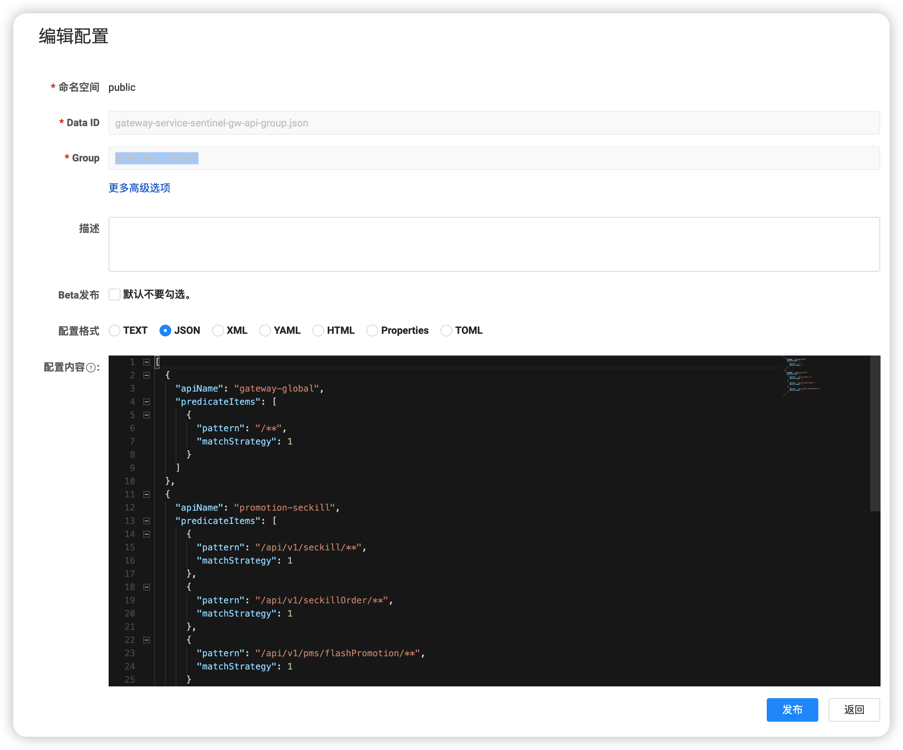
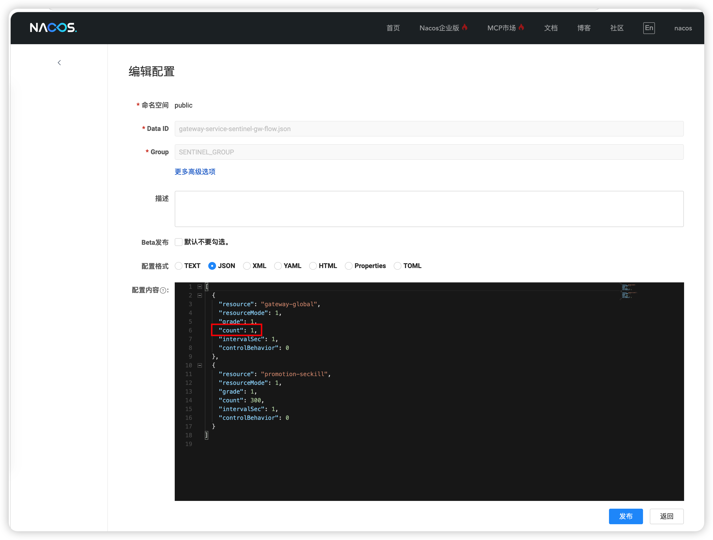
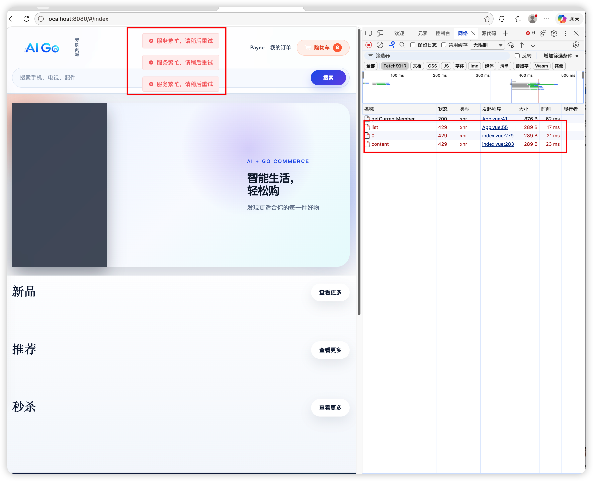
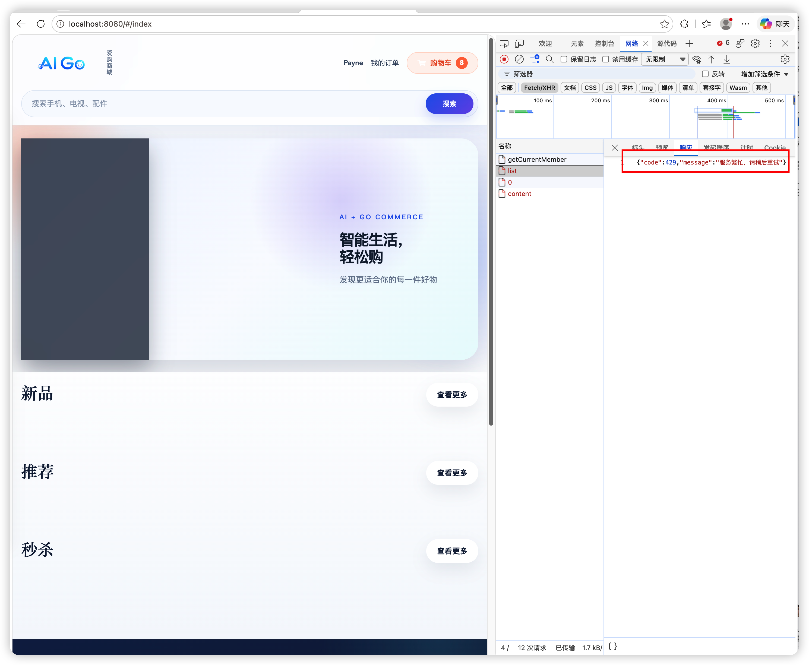

本文探讨了Spring Cloud Gateway与Sentinel的集成实践，从基础配置到高级应用，全面解析流量控制、熔断降级、系统保护等核心功能。

## 引言

Sentinel作为阿里巴巴开源的流量控制组件，为微服务架构提供了强大的流量控制、熔断降级、系统负载保护等功能。Spring Cloud Gateway作为Spring官方推荐的网关解决方案，与Sentinel的集成能够构建出高可用的网关系统。

## Spring Cloud Gateway 与 Sentinel 概述

### Spring Cloud Gateway 简介

Spring Cloud Gateway 是 Spring Cloud 官方提供的 API 网关，基于 Spring Framework 6、Project Reactor 和 Spring Boot 3 构建，运行在 Spring WebFlux + Reactor Netty 的响应式栈上，具有以下核心特性：

- 建立在 Spring Framework 6、Project Reactor 和 Spring Boot 3 之上，请求链路全程非阻塞；本项目实际使用 Spring Boot 3.5.16、Spring Cloud 2025.0.3（对应 Spring Cloud Gateway 4.3）。

- 路由匹配支持 Path、Method、Header、Query、Host、After/Before 等多种条件，目标地址支持 http:// 直连与 lb:// 服务发现两种形式。

- 支持内置网关过滤器（如 AddRequestHeader、StripPrefix、PrefixPath、RequestRateLimiter、CircuitBreaker）和自定义过滤器（GlobalFilter、GatewayFilter、GatewayFilterFactory）。

- 支持 WebSocket 代理与 HTTP/2；HTTP/2 需要 TLS 或由前置代理完成协议终止，不是打开开关即可用。

- 提供服务级熔断与降级能力：通过 Spring Cloud CircuitBreaker（如 Resilience4j）在路由上挂 CircuitBreaker + fallbackUri，也可结合 Sentinel 做网关限流与流控。

### Sentinel 简介

Sentinel 是阿里巴巴开源的面向分布式服务架构的流量控制组件，以"资源"为基本单位，在调用入口埋点后对流量做实时统计与规则判断，主要功能包括：

- 流量控制：基于 QPS、并发线程数等指标限流，支持直接/关联/链路三种流控模式，以及快速失败、Warm Up、匀速排队三种流控效果。
- 熔断降级：对不稳定的资源按慢调用比例、异常比例、异常数三种策略熔断，熔断期结束后进入半开探测。
- 系统负载保护：从入口流量维度按系统负载（Load、CPU 使用率、平均 RT、并发线程数、入口 QPS）做自适应保护，避免整体雪崩。
- 热点参数限流与授权规则：对指定参数值单独限流，以及基于调用来源（origin）的黑白名单控制。
- 实时监控：提供秒级、分钟级的资源调用统计，可通过 Sentinel Dashboard 实时查看并动态下发规则。

### 集成优势

Spring Cloud Gateway与Sentinel的集成能够带来以下优势：

- 统一的流量控制：在网关层统一进行流量控制
- 实时监控：实时监控网关的流量情况
- 快速响应：及时发现和处理流量异常
- 系统保护：保护后端服务免受流量冲击

## 在项目中集成

### Spring Cloud Gateway 使用 Sentinel

1. 在Spring Cloud Gateway服务的依赖中引入 Sentinel

```gradle
dependencies {
    implementation 'com.alibaba.cloud:spring-cloud-starter-alibaba-sentinel'
}
```

2. 修改Spring Cloud Gateway服务的配置文件`application.yml`

```yaml
spring:
    cloud:
        sentinel:
            # 需要复现无限流环境时设置 SENTINEL_ENABLED=false。
            enabled: ${SENTINEL_ENABLED:true}
            eager: true
            # 规则从本机 Nacos 的 SENTINEL_GROUP 拉取并监听变更，改完规则后无需重启网关。
            # gw-api-group 中定义全局 API（/**）和秒杀 API 分组，gw-flow 按分组名限流。
            datasource:
                gw-flow:
                nacos:
                    server-addr: ${NACOS_SERVER_ADDR:127.0.0.1:8848}
                    group-id: SENTINEL_GROUP
                    data-id: gateway-service-sentinel-gw-flow.json
                    data-type: json
                    rule-type: gw-flow
                gw-api-group:
                nacos:
                    server-addr: ${NACOS_SERVER_ADDR:127.0.0.1:8848}
                    group-id: SENTINEL_GROUP
                    data-id: gateway-service-sentinel-gw-api-group.json
                    data-type: json
                    rule-type: gw-api-group
            scg:
                # 网关自身被限流时返回的响应体。
                fallback:
                mode: response
                response-status: 429
                response-body: '{"code":429,"message":"服务繁忙，请稍后重试"}'
```

3. 在Nacos中添加限流配置

**网关全局API分组**
```
Data ID：gateway-service-sentinel-gw-api-group.json
Group：SENTINEL_GROUP
```

```json
[
  {
    "apiName": "gateway-global",
    "predicateItems": [
      {
        "pattern": "/**",
        "matchStrategy": 1
      }
    ]
  }
]
```

参数含义如下：

|参数|含义|
|---|---|
|apiName|	API| 分组名称，被 gw-flow 的 resource 引用。|
|predicateItems|	分组内的路径匹配规则，任意一条匹配即归入该分组。|
|pattern|	请求路径模式,/** 表示所有路径。|
|matchStrategy|	匹配方式：0 = 精确匹配；1 = Ant 路径匹配（网关适配器内部用 AntPathMatcher，所以 /**、/api/v1/seckill/** 有效）；2 = 正则匹配。|

**网关全局流量控制**

```
Data ID：gateway-service-sentinel-gw-flow.json
Group：SENTINEL_GROUP
```

```json
[
  {
    "resource": "gateway-global",
    "resourceMode": 1,
    "grade": 1,
    "count": 2000,
    "intervalSec": 1,
    "controlBehavior": 0
  }
]
```

参数含义如下：

| 参数 | 当前值 |	含义 |  
| ---  |---|---|
| resource |	gateway-global |限流资源名。具体含义由 resourceMode 决定：可以是路由 id，也可以是 API 分组名。这里用的是 API 分组名，对应 gateway-service-sentinel-gw-api-group.json 中的 apiName。|
|resourceMode	|1|	资源类型：0 = 按网关路由 id 限流；1 = 按自定义 API 分组限流。当前为 1，所以 resource 填的是 API 分组名。|
|grade	| 1	| 阈值类型：0 = 并发线程数；1 = QPS。当前为 QPS。|
|count	|2000 |阈值大小。grade=1 时表示每个统计窗口允许的请求数；grade=0 时表示允许的并发线程数。|
|intervalSec|1|	统计窗口，单位秒。count=2000、intervalSec=1 就是约 2000 QPS；如果是 count=100、intervalSec=10，则是平均 10 QPS。|
|controlBehavior |	0	|超出阈值后的处理方式：0 = 快速失败（直接拒绝，返回 429）；1 = Warm Up 预热；2 = 匀速排队（漏桶）；3 = 预热 + 匀速排队。当前为快速失败。|
|burst|	0	|允许的突发请求数，只在 controlBehavior=2/3（匀速排队）时生效。|
|maxQueueingTimeoutMs|	500	|匀速排队时请求最长等待时间，单位毫秒；只在 controlBehavior=2/3 时生效。|
|paramItem|	无	|热点参数限流配置，例如按客户端 IP、Header、URL 参数分别限流。当前没有启用。|

**需要时怎么调**
- 想调整总入口能力：改 gateway-global 的 count；
- 想改成“并发线程数”保护：把对应规则的 grade 改为 0，count 改为允许的并发线程数；
- 想改成排队削峰：把 controlBehavior 改为 2，再按需配置maxQueueingTimeoutMs 和 burst。

### 测试效果

为了测试限流配置是否生效，这里先把`gateway-global`的`count`的值调成`1`

```json
[
  {
    "resource": "gateway-global",
    "resourceMode": 1,
    "grade": 1,
    "count": 1,
    "intervalSec": 1,
    "controlBehavior": 0
  }
]
```


访问系统的首页：




可以看到，首页4个请求，只有一个请求是200，其它的请求为429，说明网关的请求配置生效了。