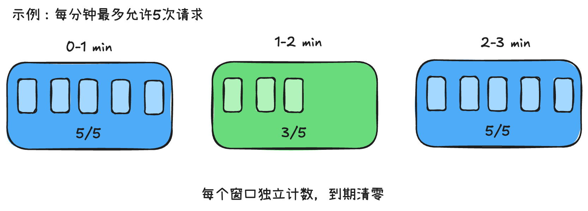
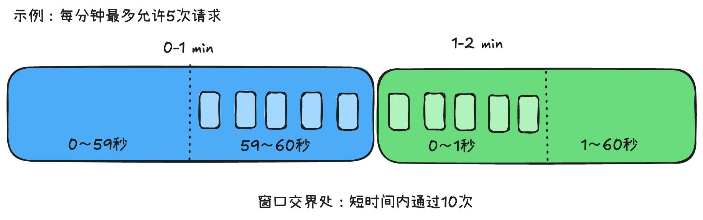
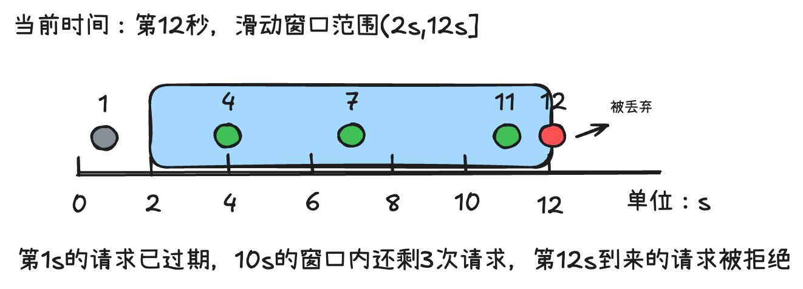
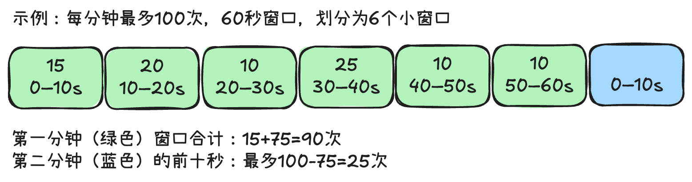
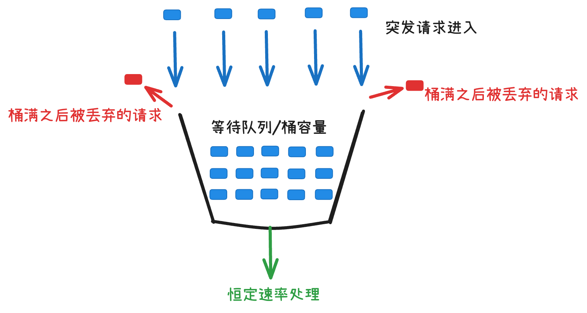

限流（Rate Limiting）是高并发系统中非常重要的一种流量控制手段，主要用于限制单位时间内的请求数量，防止系统因流量过大而出现资源耗尽、响应缓慢甚至服务崩溃。常见的限流算法主要有以下 5 种：
- 固定窗口（Fixed Window）
- 滑动窗口日志（Sliding Window Log）
- 滑动窗口计数器（Sliding Window Counter）
- 漏桶算法（Leaky Bucket）
- 令牌桶算法（Token Bucket）

## 固定窗口算法（Fixed Window）

### 工作原理

将时间划分为固定长度的窗口，例如每 1 分钟一个窗口，在每个窗口内限制最多允许 5 次请求。


假设限流规则为每分钟最多 5 次：
10:00:00～10:00:59：允许 5 次请求。
10:01:00～10:01:59：重新允许 5 次请求。

### 优点
实现简单、性能高、内存占用低，使用 Redis 的 INCR 配合过期时间即可实现。

### 缺点
#### 窗口边界突刺问题
假设每分钟允许5次请求：

如果 5 次请求集中在 10:00:59，另外 5 次请求集中在 10:01:00，那么系统可能在短短 2 秒内收到 10 次通过限流的请求。

### 使用场景

实现简单的接口限流、登录失败次数限制、非核心接口防刷、获取短信验证码等接口。

## 滑动窗口日志算法（Sliding Window Log）

### 工作原理
不再按照固定时间段清零，而是记录每一次请求的时间戳。

每次新请求到来时：

1. 删除窗口之外的过期请求记录。
2. 统计当前窗口中的请求数量。
3. 如果数量未达到上限，则允许请求并记录时间戳。
4. 否则拒绝请求。

例如限制任意 10 秒内最多 3 次请求。



如果第 12 秒又来一个新请求，则因为窗口内已经存在 3 次请求，新请求被拒绝。

### 优点
能够精确控制任意连续时间窗口内的请求数量，解决固定窗口的边界突刺问题。

### 缺点
需要记录每次请求的时间戳，内存占用与窗口内请求数相关。高并发时存储和维护成本较高。

### 实现

通常使用Redis的`ZSET`，以时间戳作为Score，并为每个请求生成唯一 Member，配合`ZREMRANGEBYSCORE`、`ZCARD`和`ZADD`，通过 Lua 保证原子性。

### 使用场景
需要精确限制某个用户每分钟调用次数的 API、金融接口等。

## 滑动窗口计数器算法（Sliding Window Counter）

这是固定窗口和滑动窗口日志的折中方案。

### 工作原理

将一个较大的时间窗口划分成多个小窗口，每个小窗口只保存请求计数，而不保存每个请求的时间戳。

例如每分钟最多100次请求，将60秒划分为6个10秒的小窗口。

随着时间推进，窗口会持续滑动，旧的小窗口被移除，新的小窗口加入统计。

### 优点
相比滑动窗口日志，内存占用更少；相比固定窗口，能够有效缓解边界突刺问题。

### 缺点
如果按小窗口的完整计数统计，会存在一定的精度误差。小窗口越小，通常精度越高，但维护成本也越大。还有一种常见实现是双窗口加权计数，只使用当前固定窗口和上一个固定窗口，按时间比例估算请求数量。例如上一分钟有 80 次请求，当前分钟有 30 次请求，当前分钟已过去 25%：
```math
N\approx80\times(1-0.25)+30=90
```
这种方式资源开销更低，但它是对真实滑动窗口请求数量的估算。

### 适用场景
API 网关、Redis 分布式限流、大规模用户级限流。

## 漏桶算法（Leaky Bucket）
### 工作原理
可以把漏桶理解为一个底部有小孔的水桶。
请求相当于往桶里倒水，而桶底的孔以固定速率向外排水。


假设桶容量为 100，每秒处理 10 个请求。

当 100 个请求同时到来时，允许它们进入队列，但按照每秒 10 个的速率处理。桶满以后，新到达的请求会被拒绝或者丢弃。

### 优点
输出速率平稳，可以有效削峰，避免下游服务受到瞬时大流量冲击。

### 缺点
如果实现为真实的排队漏桶，请求可能需要等待较长时间，不适合对响应延迟敏感的接口。

### 使用场景
消息消费速率控制、第三方接口调用、需要稳定吞吐的下游服务。

## 令牌桶算法（Token Bucket）

### 工作原理

系统以固定速率向桶中添加令牌，桶有最大容量。

每次请求都必须先获取令牌：
- 获取成功：允许请求。
- 获取失败：拒绝请求或等待令牌。
- 桶满以后：新生成的令牌直接丢弃。


假设限流配置如下：
- 令牌生成速率：每秒 10 个。
- 桶容量：100 个。
- 每次请求消耗 1 个令牌。

在桶已经装满的情况下，即使突然出现 100 个请求，也可以全部通过。随后，如果请求持续到达，长期通过速率将受到每秒 10 个令牌的限制。

### 令牌桶计算公式
令：
```math 
B：桶最大容量  \\
r：令牌生成速率（个/秒）\\
T：距离上次更新经过的时间（秒）\\
N：上次更新后剩余的令牌数
```

那么当前可用令牌数为：
```math
N_{\text{new}}=\min(B,N+r\times T)
```
请求获取成功后，从当前令牌数量中扣除所需令牌。

### 优点
同时支持平均速率限制和一定程度的突发流量，灵活性较高，而且无需真正地按固定周期生成令牌，可以在请求到来时按时间差计算。

### 缺点
如果桶容量配置过大，可能放行大量突发请求，瞬间压垮下游系统，因此令牌桶并不等于绝对平滑流量。
